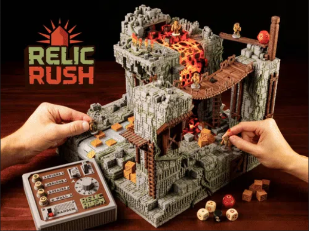
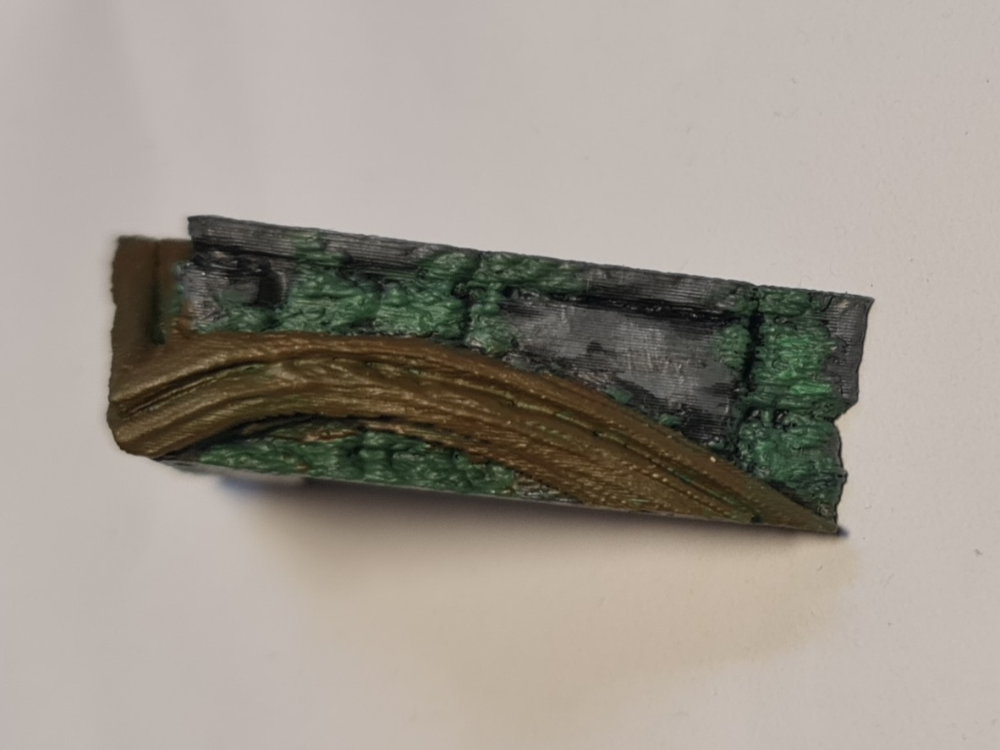
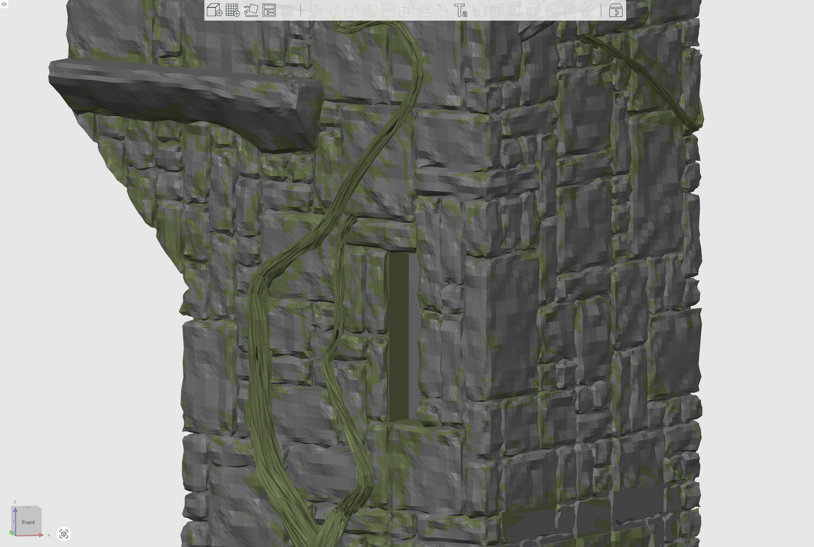
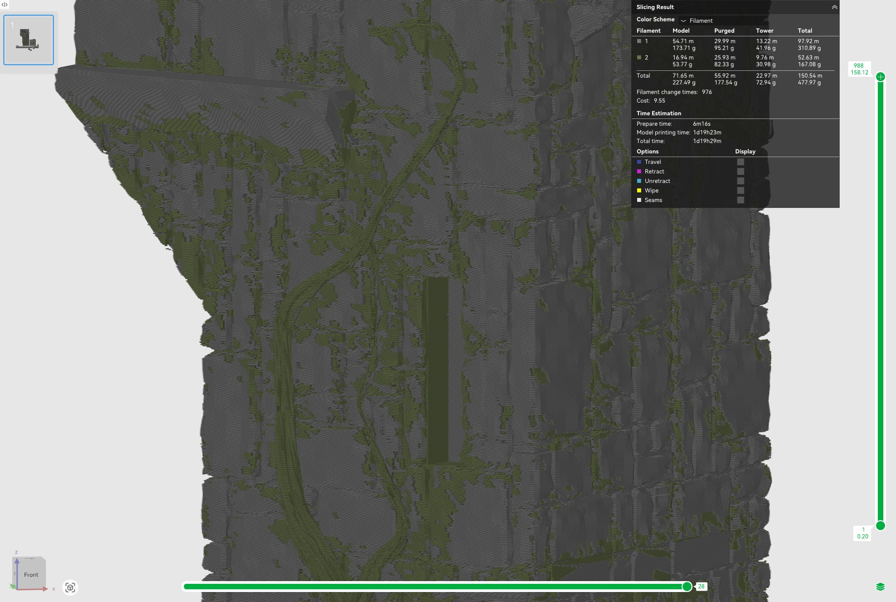
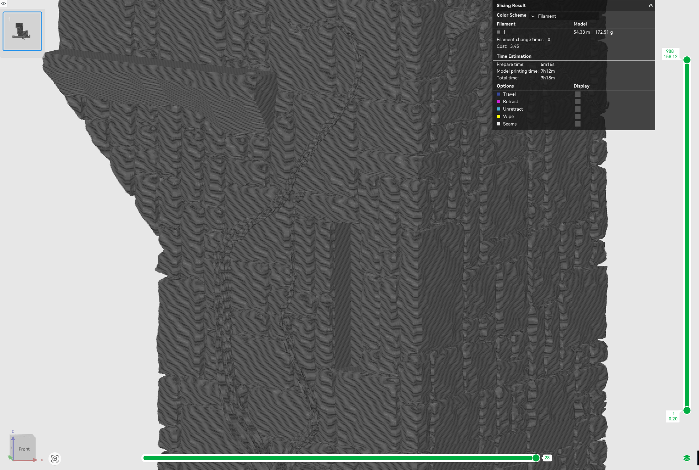
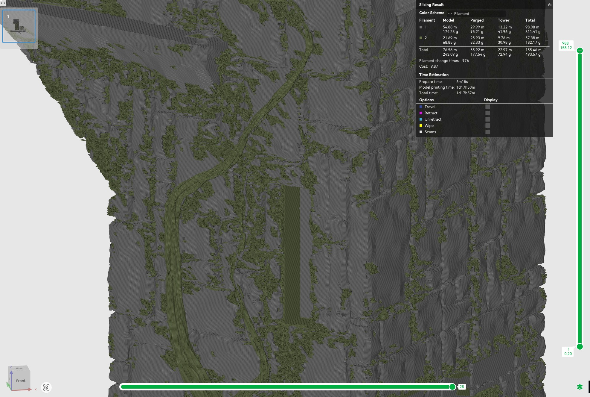
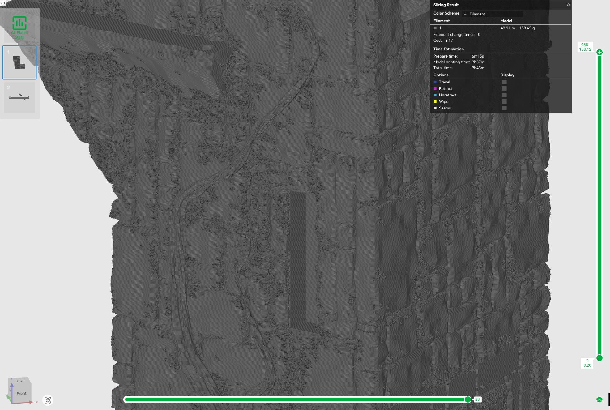

<div align="center">


# FuzzyPaint

**Turn Bambu Studio colour painting into tactile surface detail, print it in one filament, then paint the finished model by hand.**

[](https://github.com/Woogie-Maker/FuzzyPaint/releases)
[](#quick-start)
[](#running-from-source)
[](#architecture)
[](LICENSE)

[Download the latest release](https://github.com/Woogie-Maker/FuzzyPaint/releases) · [Workflow guide](WORKFLOW.md) · [Changelog](CHANGELOG.md)

</div>

FuzzyPaint converts filament colour painting in a Bambu Studio or OrcaSlicer project into fuzzy-skin painting.

It works directly with the per-triangle paint masks, preserving fine brush boundaries and Bambu's
internally subdivided triangles.

Its two-stage workflow can then preserve those painted-region boundaries as
physical outline detours while removing colour changes, purging, and the prime
tower from the final sliced file.

## Why FuzzyPaint exists

FuzzyPaint began with a real printing project: the beautifully designed [Relic Rush board game on MakerWorld](https://makerworld.com/en/models/2046733-relic-rush-board-game#profileId-2208645).<br>
Its towering ruins, stonework, vines, moss, and lava made it an irresistible model to print.

<div align="center">
  <a href="https://makerworld.com/en/models/2046733-relic-rush-board-game#profileId-2208645">
    
  </a>
  <br>
  <em>Relic Rush — the board game whose richly detailed terrain inspired FuzzyPaint. Click the image to view the original model on MakerWorld.</em>
</div>

<br>

With the goal of printing it in a single colour and painting it by hand
afterwards, I realised there was a gap in the normal workflow. Bambu Studio's
colour painting showed exactly where every organic detail belonged, but that
guidance disappeared when the model was sliced in one colour. Printing the
painted regions in a second filament preserved the colour, but at the cost of
hundreds of filament changes, substantial purge waste, a prime tower,
dramatically longer print times, and far greater filament use.

That gap led to FuzzyPaint: turn the painted detail into real texture, retain
its boundaries, and produce a practical single-filament model ready for hand
painting. The Bridge Tower examples below come directly from that original
Relic Rush project.

## Print in one colour. Paint it by hand.

A major use case for FuzzyPaint is producing **single-colour models designed
for hand painting**. The colour painting you already created in Bambu Studio
becomes a physical map on the print: selected regions gain texture, while the
outline detours preserve their detailed boundaries.

This gives you both parts of the original artistic intent after the filament
colours are removed:

- **A visible and tactile painting guide** showing where each painted region
  belongs on the finished model.
- **Real surface texture** that adds character after painting instead of
  relying on colour alone.
- **A practical single-filament print** without hundreds of colour changes,
  purge waste, or a prime tower.

Print the model in one suitable base colour, then use the textured regions and
their outlines to guide brush painting. Fine moss, weathering, fur, corrosion,
stone variation, and similar painted details can become physical features that
remain easy to identify when applying the final colours by hand.

<div align="center">
  <a href="docs/assets/hand-painted-example.jpg">
    
  </a>
  <br>
  <em>A single-filament FuzzyPaint test piece after hand painting. The converted paint mask gives the moss real texture and clear boundaries, making it straightforward to pick out in green while painting the vine and surrounding stone separately.</em>
</div>

## See the difference

Click any image for the full-size view. The linked gallery pages include
visible **previous** and **next** controls for stepping through the sequence.

<table>
  <tr>
    <td width="20%"><a href="docs/gallery/01-original-paint.md"></a></td>
    <td width="20%"><a href="docs/gallery/02-original-paint-sliced.md"></a></td>
    <td width="20%"><a href="docs/gallery/03-original-single-colour.md"></a></td>
    <td width="20%"><a href="docs/gallery/04-fuzzypaint-sliced.md"></a></td>
    <td width="20%"><a href="docs/gallery/05-fuzzypaint-single-colour.md"></a></td>
  </tr>
  <tr>
    <td align="center"><strong>1. Painted source</strong><br>Colour marks the surfaces to texture.</td>
    <td align="center"><strong>2. Original slice</strong><br>Paint becomes a costly second filament.</td>
    <td align="center"><strong>3. Plain single colour</strong><br>The painted detail disappears.</td>
    <td align="center"><strong>4. FuzzyPaint slice</strong><br>Painted regions become surface texture.</td>
    <td align="center"><strong>5. Ready to print and paint</strong><br>Texture guides hand painting with zero filament changes.</td>
  </tr>
</table>

## Example files

Download the Bridge Tower example at either stage of the workflow:

- [Prepared editable project (12.0 MiB)](<examples/Bridge Tower Plate (FP-Prepped).3mf>)
- [Finished single-filament sliced file (54.0 MiB)](<examples/Bridge Tower Plate (FP-Print_Ready).gcode.3mf>)

The prepared `.3mf` can be opened and sliced normally in Bambu Studio. The
finished `.gcode.3mf` is already sliced: open it in Preview to inspect the
single-filament result, but do not pass it through FuzzyPaint a second time.

## What it does

- Converts selected painted filament slots into fuzzy-skin masks.
- Retains the original colour painting by default, so existing multicolour
  projects remain usable.
- Protects large flat areas, narrow fitting surfaces, and related smooth
  geometry from unwanted texture.
- Uses Bambu Studio's installed slicer and the complete profiles already stored
  in the project.
- Rebuilds painted boundaries as physical inset outline detours.
- Produces a print-ready `.gcode.3mf` with one model filament, no colour swaps,
  and no prime tower.
- Turns digital colour painting into a visible and tactile guide for painting
  the finished single-colour print by hand.
- Never overwrites the source project.

## Architecture

FuzzyPaint is a hybrid Python and Rust application:

- The Windows interface, project workflow, Bambu Studio integration, and
  compatibility paths are written in Python 3.15 using the standard library
  and Tkinter.
- Performance-sensitive mesh protection and G-code processing run in a bundled
  Rust 2024 engine connected to Python through PyO3 0.30.1.
- Python fallbacks remain available when running from source without a
  compatible compiled Rust extension.

This keeps the application easy to run and inspect while moving the expensive
geometry and toolpath work into native code.

## Quick start

> [!IMPORTANT]
> Start with a **3MF project** saved from Bambu Studio or OrcaSlicer. STL files
> do not contain face-painting data.

1. Download and extract the latest Windows release, then open
   **Start FuzzyPaint.bat**.
2. On **1 Prepare project**, select the colour-painted `.3mf`, choose a new
   output filename, and enter the painted filament slot (for example `2` or
   `2,4`). Use `all` to convert every painted slot.
3. Leave **Keep large flat areas smooth** enabled when slots, mating faces,
   recesses, or other dimensional surfaces must retain their fit.
4. Normally keep the recommended retraction, wipe, sloped Z-hop, and attachment
   cleanup options selected, then click **Prepare file for slicing**.
5. On **2 Create single-filament file**, leave **Balanced — proven settings**
   and **Both — complete outline** selected, then click
   **Create single-filament print file**.
6. Open the resulting `(FP-Print_Ready).gcode.3mf` in Bambu Studio and inspect
   the complete Preview before printing.
7. Print with one filament, then use the retained texture and outline detail as
   the guide for painting the finished model by hand.

FuzzyPaint automatically runs the installed Bambu Studio slicer using the
printer, filament, and process profiles embedded in the prepared project. The
regular Bambu Studio window may remain open.

For file naming, the manual slicing fallback, and an explanation of every
stage, see the [complete workflow guide](WORKFLOW.md).

## Recommended defaults

The Windows GUI starts with settings chosen for the detailed single-filament
workflow:

- **Disable retractions** is enabled. FuzzyPaint sets the process fallback and
  each virtual-filament override to zero before slicing.
- **Disable wipe while retracting** is enabled. If retractions are turned back
  on for a particular model or material, this remains independently togglable.
- **Use sloped Z-hop for every filament** is enabled. This changes the lift
  type while preserving the project's existing Z-hop heights.
- **Keep large flat areas smooth** is enabled. The validated profile protects
  large planar patches from 90 mm², compact strips from 30 mm², related
  coplanar groups, flat contacts, and the neighbouring fuzz envelope.
- Embedded guides and downloads are removed from the prepared copy; guides,
  pictures, and downloads are removed from the final sliced file. Geometry,
  thumbnails, and print-profile settings are retained.

The slower disconnected-overlap and non-manifold-debris checks are available
for difficult meshes but are off by default. Coincident-surface protection is
experimental and also off by default.

## Manual slicing fallback

If automatic slicing is unavailable:

1. Open the prepared project in Bambu Studio and slice it.
2. Use **Print plate ▾ → Export plate sliced file**.
3. Select the exported `.gcode.3mf` on FuzzyPaint's second tab.
4. Create the final single-filament file and inspect it in Preview.

Colour changes and a prime tower are expected in the intermediate sliced file;
FuzzyPaint removes them in step 2.

## Running from source

The v0.12.1 source launcher and Windows package target Python 3.15.2. The Python
application uses only the standard library. Release builds bundle the PyO3
0.30.1 Rust engine used by both project preparation and G-code processing.

```powershell
python fuzzypaint.py input.3mf output-fuzzy.3mf
python fuzzypaint.py input.3mf output-fuzzy.3mf --slots 2,4
python fuzzypaint.py input.3mf output-fuzzy.3mf --remove-colour
python fuzzypaint.py input.3mf output-fuzzy.3mf --slots 2 --protect-planar
python fuzzypaint.py input.3mf output-single.3mf --slots 2 --protect-planar --single-colour
```

The command-line `--protect-planar` option uses its own 20 mm² threshold. The
GUI applies the broader validated smooth-surface profile described above.

### Sliced-path outline detours

`gcode_layer_interval_detour.py` operates on Bambu Studio's exported **plate
sliced file** (`.gcode.3mf`). At cross-layer virtual-colour boundaries, it
reconstructs the affected outer-wall run as an inward connector, a parallel
inset span, and an outward connector. It then removes the slicer's colour
changes and wipe tower and packages the result as a true single-filament sliced
file.

```powershell
python gcode_layer_interval_detour.py input.gcode.3mf output-detour.gcode.3mf --inset 0.24 --boundary-resolution 0.10 --endpoint-coverage 0.21 --same-layer-gap 0 --detour-side both --detour-filaments 2
```

This is a G-code postprocessor. Do not use it on an unsliced project 3MF.

## Notes and limitations

- Colour painting means Bambu's `paint_color` face data. Separate coloured
  model parts assigned to different filaments are not paint masks and are not
  converted.
- On a triangle that already has fuzzy paint and colour paint, the converted
  colour mask replaces that triangle's previous fuzzy mask. Fuzzy paint on all
  other triangles is preserved.
- Step 1 retains the temporary colour boundaries needed to construct accurate
  outline detours. Step 2 removes the resulting filament changes, purging, and
  prime tower.
- The old two-virtual-filament/single-spool experiment is not exposed in the
  GUI. Mapping both virtual colours to one AMS tray cannot remove logical
  filament changes generated by the slicer.
- Preparation and outline analysis are CPU operations. Release builds use the
  bundled Rust engine; Bambu Studio slicing remains a separate external
  operation. GPU acceleration is not currently used.

> [!CAUTION]
> FuzzyPaint changes project geometry settings and sliced toolpaths. Always
> inspect the entire final Preview before sending a long print to the printer.

## Tests

```powershell
& "$env:LOCALAPPDATA\Programs\Python\Python315\python.exe" -m unittest discover -s tests -v
```

## Licence

FuzzyPaint's source code and original documentation are available under the
[MIT License](LICENSE). Third-party and Relic Rush-derived example files,
screenshots, and imagery are not covered by the FuzzyPaint software licence;
see [ASSET_NOTICE.md](ASSET_NOTICE.md) for details. Bundled third-party
components retain their respective licences.

## Release notes

v0.12.1 adds the MIT licence, makes the Python/Rust architecture prominent,
and exposes GitHub and the full licence directly from the app's About window.

v0.12.0 moves the Windows application and bundled Rust extension to Python
3.15.2 and PyO3 0.30.1 without changing conversion defaults or output
behaviour. It also reuses an existing Explorer window when that window already
shows the exact output folder.

See [CHANGELOG.md](CHANGELOG.md) for the complete history.
