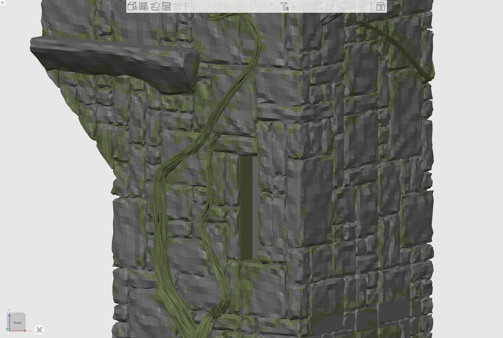

# 1 of 5 — Original colour-painted model

| [← Back to README](../../README.md#see-the-difference) | [Next →](02-original-paint-sliced.md) |
|:---|---:|

The green face painting marks the moss and vine detail that will become
physical surface texture.

| [← Back to README](../../README.md#see-the-difference) | [Next →](02-original-paint-sliced.md) |
|:---|---:|
