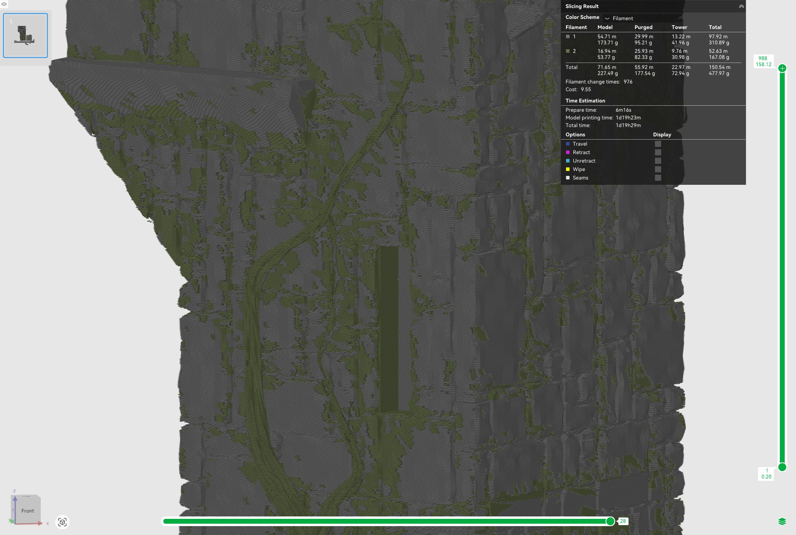

# 2 of 5 — Original multicolour slice

| [← Previous](01-original-paint.md) | [Next →](03-original-single-colour.md) |
|:---|---:|

The original paint survives slicing as a second filament, bringing colour
changes, purging, and a prime tower.

| [← Previous](01-original-paint.md) | [Next →](03-original-single-colour.md) |
|:---|---:|
