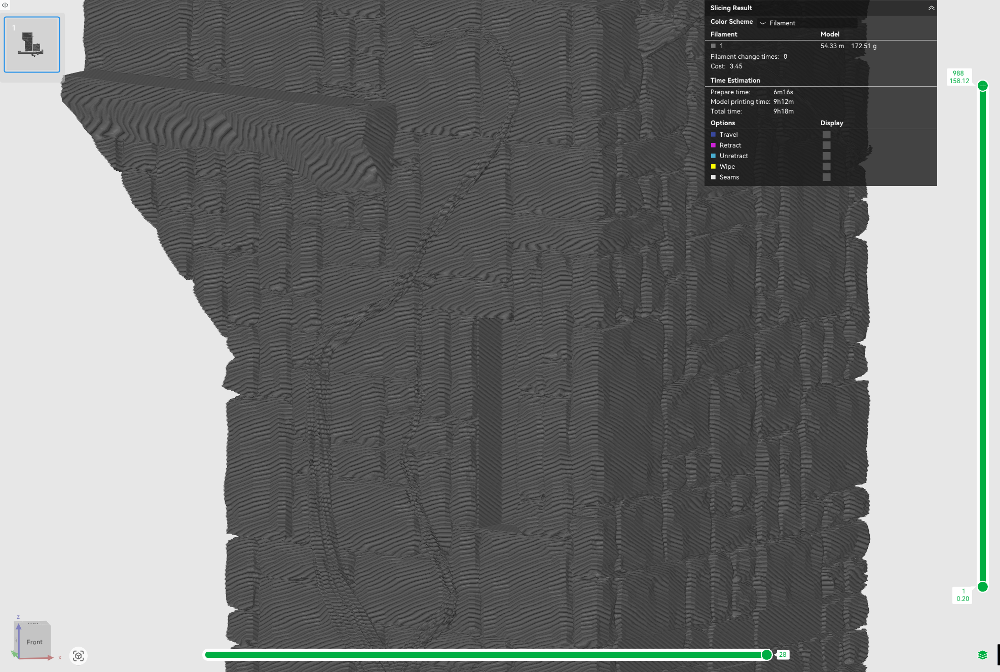

# 3 of 5 — Ordinary single-colour slice

| [← Previous](02-original-paint-sliced.md) | [Next →](04-fuzzypaint-sliced.md) |
|:---|---:|

Simply slicing the source in one colour removes the painted distinction; the
moss pattern is no longer represented in the toolpath.

| [← Previous](02-original-paint-sliced.md) | [Next →](04-fuzzypaint-sliced.md) |
|:---|---:|
