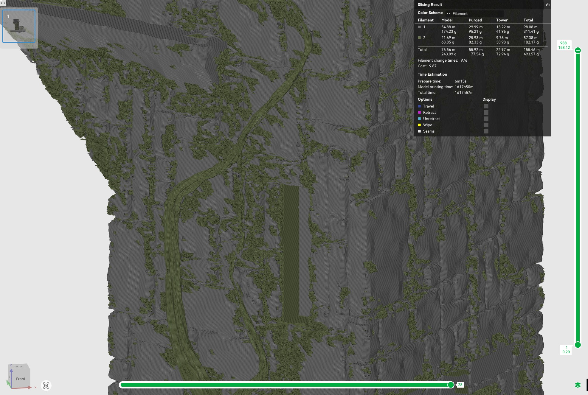

# 4 of 5 — FuzzyPaint multicolour slice

| [← Previous](03-original-single-colour.md) | [Next →](05-fuzzypaint-single-colour.md) |
|:---|---:|

FuzzyPaint turns the painted moss regions into visible fuzzy-skin toolpaths
while keeping their detailed boundaries.

| [← Previous](03-original-single-colour.md) | [Next →](05-fuzzypaint-single-colour.md) |
|:---|---:|
