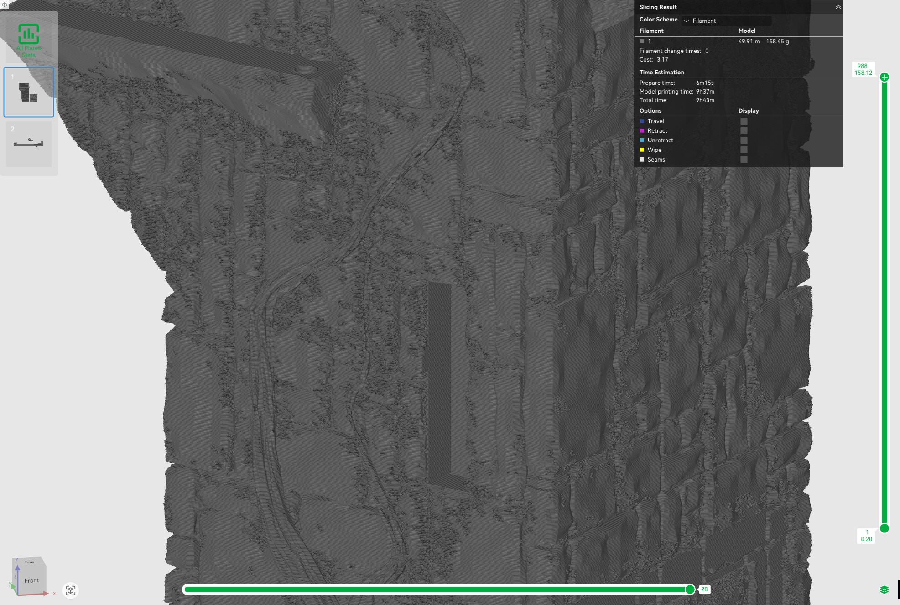

# 5 of 5 — Final single-filament FuzzyPaint result

| [← Previous](04-fuzzypaint-sliced.md) | [Back to README →](../../README.md#see-the-difference) |
|:---|---:|

The final print-ready file retains the textured moss detail as physical
toolpaths while using one model filament and zero filament changes.

| [← Previous](04-fuzzypaint-sliced.md) | [Back to README →](../../README.md#see-the-difference) |
|:---|---:|
